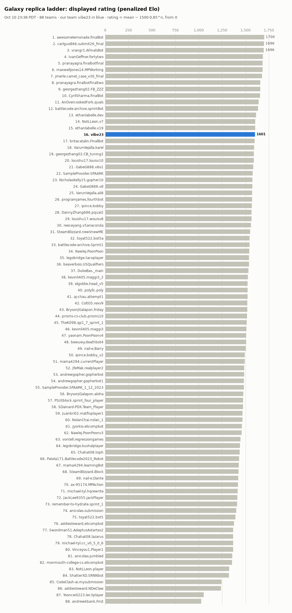

# Galaxy replica ladder

Snapshot of the Rankings page of our private galaxy replica (https://galaxy.136-86-167-127.sslip.io/bc23/rankings), taken Oct 17 22:53 PDT. Written by `tools/galaxy/snapshot.py`: regenerate it, do not edit it. The live site, with replays, is described in ACCESS.md.

**Rating is the galaxy replica's displayed rating**: siarnaq's penalized Elo, mean − 1500·0.85^n after n rated matches, so every team starts at 0 and climbs over its first ~20 ranked matches. It is not the Bradley-Terry fit of `progress/ELO.md`. 88 teams (88 with an accepted submission). Games W-L counts the games recorded in `progress/games.csv` from the replica (88 teams have some); our team is **vibe23**, whose builds appear there as `us:<package>`.

| # | Team | Rating | Games W-L | Submission |
|---:|---|---:|---|---|
| 1 | maxwelljones14.MPWorking | 1820.6 | 180-87 | accepted |
| 2 | awesomelemonade.finalBot | 1797.9 | 532-168 | accepted |
| 3 | carlguo866.submit26\_final | 1773.3 | 167-115 | accepted |
| 4 | IvanGeffner.fortytwo | 1768.4 | 202-104 | accepted |
| 5 | vrangr1.AFinalsBot | 1748.4 | 493-216 | accepted |
| 6 | georgezhang02.FB\_ZZZ | 1731.5 | 216-135 | accepted |
| 7 | battlecode-archive.sprintBot | 1724.8 | 213-144 | accepted |
| 8 | pranayagra.finalbotfinal | 1709.3 | 519-322 | accepted |
| 9 | AnOvercookedFork.quals | 1704.1 | 190-125 | accepted |
| 10 | jmerle.camel\_case\_v30\_final | 1703.4 | 504-307 | accepted |
| 11 | pranayagra.finalbotfinaltwo | 1685.7 | 200-136 | accepted |
| 12 | **vibe23** | 1681.1 | 3436-2823 | accepted |
| 13 | CyrilSharma.finalBot | 1673.7 | 240-183 | accepted |
| 14 | georgezhang02.CB\_tuning2 | 1663.6 | 387-481 | accepted |
| 15 | NotLLeon.v7 | 1650.5 | 406-462 | accepted |
| 16 | britacatalin.FinalBot | 1635.3 | 337-474 | accepted |
| 17 | VarunVejalla.karel | 1630.1 | 230-229 | accepted |
| 18 | ethanlabelle.dev | 1628.2 | 237-204 | accepted |
| 19 | VarunVejalla.ali8 | 1627.0 | 189-159 | accepted |
| 20 | GabeG888.v8o1 | 1623.9 | 197-154 | accepted |
| 21 | GabeG888.v8 | 1615.3 | 204-159 | accepted |
| 22 | programjames.fourthbot | 1609.8 | 201-165 | accepted |
| 23 | ethanlabelle.v19 | 1602.8 | 218-226 | accepted |
| 24 | DannyZhang686.pqual2 | 1597.5 | 204-189 | accepted |
| 25 | louishu17.louisv10 | 1591.5 | 186-156 | accepted |
| 26 | NicholasKelly15.gopher10 | 1584.1 | 181-149 | accepted |
| 27 | TheK098.qp1\_7\_sprint\_1 | 1580.2 | 208-176 | accepted |
| 28 | battlecode-archive.Sprint1 | 1572.7 | 236-542 | accepted |
| 29 | ipince.bobby | 1571.2 | 172-155 | accepted |
| 30 | reeceyang.v5anaconda | 1570.0 | 272-539 | accepted |
| 31 | SampleProvider.SPAARK | 1569.2 | 177-165 | accepted |
| 32 | beaverbois.USQualifiers | 1567.0 | 206-181 | accepted |
| 33 | louishu17.wouisv8 | 1562.0 | 190-179 | accepted |
| 34 | polyllc.poly | 1557.3 | 166-164 | accepted |
| 35 | legobridge.tacoplayer | 1549.6 | 187-203 | accepted |
| 36 | SteamBlizzard.newVnewME | 1546.0 | 200-196 | accepted |
| 37 | toyat522.bot5a | 1545.9 | 195-204 | accepted |
| 38 | kevinli405.maggi3 | 1545.3 | 205-206 | accepted |
| 39 | elgoldie.head\_v5 | 1545.2 | 189-189 | accepted |
| 40 | ColtG5.rexv9 | 1536.7 | 202-203 | accepted |
| 41 | DukeBas.\_main | 1534.2 | 216-183 | accepted |
| 42 | kevinli405.maggi3\_2 | 1529.2 | 217-203 | accepted |
| 43 | yaonam.PoonPoonv4 | 1528.9 | 247-603 | accepted |
| 44 | BrysonJGalapon.friday | 1526.9 | 207-189 | accepted |
| 45 | mama4294.currentPlayer | 1521.3 | 211-209 | accepted |
| 46 | nail-e.Barry | 1519.6 | 202-203 | accepted |
| 47 | Nawlej.PoonPoon | 1517.2 | 185-184 | accepted |
| 48 | prisms-cs-club.prisms10 | 1516.7 | 217-194 | accepted |
| 49 | aj-chau.attempt1 | 1508.8 | 214-206 | accepted |
| 50 | JfeMak.realplayer2 | 1504.6 | 233-232 | accepted |
| 51 | ipince.bobby\_v2 | 1498.4 | 234-231 | accepted |
| 52 | BrysonJGalapon.aloha | 1492.1 | 252-240 | accepted |
| 53 | andrewgopher.gopherbot | 1490.9 | 214-245 | accepted |
| 54 | bewuwy.deathbot4 | 1480.4 | 250-254 | accepted |
| 55 | SDainard-PDX.Team\_Player | 1477.9 | 210-237 | accepted |
| 56 | PSUtblock.sprint\_four\_player | 1468.7 | 215-235 | accepted |
| 57 | SampleProvider.SPAARK\_1\_12\_2023 | 1467.7 | 261-240 | accepted |
| 58 | Nawlej.PoonPoonv3 | 1466.7 | 236-259 | accepted |
| 59 | NolanChai.nolan\_1 | 1460.0 | 246-261 | accepted |
| 60 | andrewgopher.gopherbot1 | 1446.0 | 222-249 | accepted |
| 61 | jyorkio.elicompbot | 1444.6 | 236-244 | accepted |
| 62 | Juanbri02.matfisplayer1 | 1431.2 | 248-247 | accepted |
| 63 | vontell.regressiongames | 1411.4 | 244-266 | accepted |
| 64 | michael-tyl.hqrewrite | 1409.8 | 227-241 | accepted |
| 65 | legobridge.kushalplayer | 1409.3 | 215-241 | accepted |
| 66 | SteamBlizzard.Block | 1407.9 | 238-266 | accepted |
| 67 | Patela171.Battlecode2023\_Robot | 1403.5 | 229-254 | accepted |
| 68 | mama4294.learningBot | 1395.9 | 250-254 | accepted |
| 69 | JackLee9355.jackPlayer | 1392.2 | 201-255 | accepted |
| 70 | Chahat08.toph | 1391.4 | 234-264 | accepted |
| 71 | ax-95174.MPAction | 1388.5 | 228-270 | accepted |
| 72 | nail-e.Dante | 1377.6 | 260-256 | accepted |
| 73 | remember-to-hydrate.sprint\_1 | 1362.5 | 237-270 | accepted |
| 74 | Swordman51.AdeptusAstartes2 | 1349.6 | 258-279 | accepted |
| 75 | anicolao.submission | 1347.2 | 257-292 | accepted |
| 76 | toyat522.bot5 | 1339.2 | 249-306 | accepted |
| 77 | monmouth-college-cs.elicompbot | 1332.3 | 257-307 | accepted |
| 78 | Chahat08.lazarus | 1332.2 | 256-299 | accepted |
| 79 | Vinceyou1.Player1 | 1331.1 | 233-265 | accepted |
| 80 | michael-tyl.cc\_v0\_5\_0\_6 | 1329.2 | 280-314 | accepted |
| 81 | addiesteward.elicompbot | 1320.9 | 242-289 | accepted |
| 82 | anicolao.jumbled | 1281.1 | 267-303 | accepted |
| 83 | ShatterXD.SRNNbot | 1257.9 | 267-291 | accepted |
| 84 | NotLLeon.player | 1209.4 | 260-274 | accepted |
| 85 | CodeClash-ai.mysubmission | 1142.5 | 271-296 | accepted |
| 86 | addiesteward.NDeClaw | 1137.0 | 234-276 | accepted |
| 87 | Yooncw0223.lec3player | 908.5 | 91-395 | accepted |
| 88 | andrewkbank.First | 799.6 | 56-343 | accepted |

## Latest matches

| Match | Created | Player 0 | Score | Player 1 | Maps | Type | Status |
|---:|---|---|---|---|---|---|---|
| 9050 | Oct 17 22:51 PDT | AnOvercookedFork.quals | ?–? | **vibe23** | Sakura, LightWork, Buggy | ranked | RUN |
| 9049 | Oct 17 22:46 PDT | AnOvercookedFork.quals | ?–? | **vibe23** | Pakbot, Cornucopia, SmallElements | ranked | RUN |
| 9048 | Oct 17 21:48 PDT | **vibe23** | 9–1 | britacatalin.FinalBot | DefaultMap, Maze, Forest, ReverseFunnel, Cat, IslandHopping, Hah, BatSignal, Cornucopia, MassiveL | unranked | OK! |
| 9047 | Oct 17 21:48 PDT | **vibe23** | 10–0 | yaonam.PoonPoonv4 | DefaultMap, Maze, Forest, ReverseFunnel, Cat, IslandHopping, Hah, BatSignal, Cornucopia, MassiveL | unranked | OK! |
| 9046 | Oct 17 21:47 PDT | **vibe23** | 10–0 | reeceyang.v5anaconda | DefaultMap, Maze, Forest, ReverseFunnel, Cat, IslandHopping, Hah, BatSignal, Cornucopia, MassiveL | unranked | OK! |
| 9045 | Oct 17 21:47 PDT | **vibe23** | 10–0 | battlecode-archive.Sprint1 | DefaultMap, Maze, Forest, ReverseFunnel, Cat, IslandHopping, Hah, BatSignal, Cornucopia, MassiveL | unranked | OK! |
| 9044 | Oct 17 21:47 PDT | **vibe23** | 7–3 | NotLLeon.v7 | DefaultMap, Maze, Forest, ReverseFunnel, Cat, IslandHopping, Hah, BatSignal, Cornucopia, MassiveL | unranked | OK! |
| 9043 | Oct 17 21:47 PDT | **vibe23** | 5–5 | pranayagra.finalbotfinal | DefaultMap, Maze, Forest, ReverseFunnel, Cat, IslandHopping, Hah, BatSignal, Cornucopia, MassiveL | unranked | OK! |
| 9042 | Oct 17 21:47 PDT | **vibe23** | 3–7 | awesomelemonade.finalBot | DefaultMap, Maze, Forest, ReverseFunnel, Cat, IslandHopping, Hah, BatSignal, Cornucopia, MassiveL | unranked | OK! |
| 9041 | Oct 17 21:47 PDT | **vibe23** | 10–0 | georgezhang02.CB\_tuning2 | DefaultMap, Maze, Forest, ReverseFunnel, Cat, IslandHopping, Hah, BatSignal, Cornucopia, MassiveL | unranked | OK! |
| 9040 | Oct 17 21:47 PDT | **vibe23** | 4–6 | jmerle.camel\_case\_v30\_final | DefaultMap, Maze, Forest, ReverseFunnel, Cat, IslandHopping, Hah, BatSignal, Cornucopia, MassiveL | unranked | OK! |
| 9039 | Oct 17 21:47 PDT | **vibe23** | 5–5 | vrangr1.AFinalsBot | DefaultMap, Maze, Forest, ReverseFunnel, Cat, IslandHopping, Hah, BatSignal, Cornucopia, MassiveL | unranked | OK! |
| 9038 | Oct 17 21:37 PDT | **vibe23** | 1–2 | pranayagra.finalbotfinal | Pakbot, ThirtyFive, Pathfind | ranked | OK! |
| 9037 | Oct 17 21:31 PDT | **vibe23** | 1–2 | georgezhang02.FB\_ZZZ | IslandHoppingTwo, TimesUp, HotAirBalloon | ranked | OK! |
| 9036 | Oct 17 21:26 PDT | **vibe23** | 1–2 | georgezhang02.FB\_ZZZ | VeryReasonable, Flower, BatSignal | ranked | OK! |
| 9035 | Oct 17 21:21 PDT | georgezhang02.FB\_ZZZ | 1–2 | **vibe23** | Eyelands, Buggy, USA | ranked | OK! |
| 9034 | Oct 17 21:16 PDT | jmerle.camel\_case\_v30\_final | 1–2 | **vibe23** | Pizza, Flower, Star | ranked | OK! |
| 9033 | Oct 17 21:11 PDT | **vibe23** | 1–2 | jmerle.camel\_case\_v30\_final | IslandHopping, Maze, Piglets | ranked | OK! |
| 9032 | Oct 17 21:06 PDT | jmerle.camel\_case\_v30\_final | 1–2 | **vibe23** | ThirtyFive, Jail, Rainbow | ranked | OK! |
| 9031 | Oct 17 21:00 PDT | **vibe23** | 1–2 | battlecode-archive.sprintBot | Lines, Risk, BowAndArrow | ranked | OK! |
