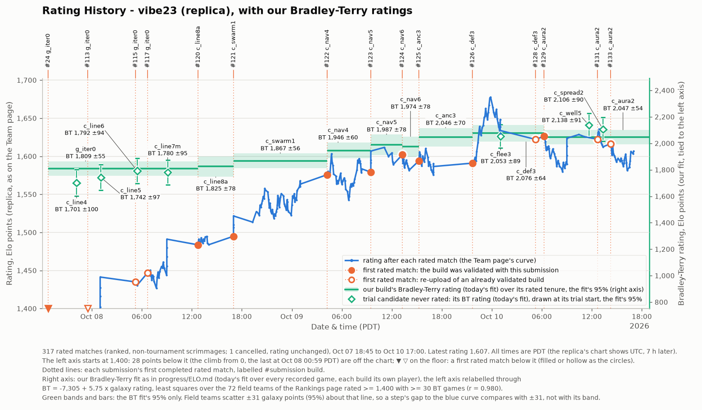

# Rating history (replica)

The replica's Team Settings > Rating History chart for vibe23: siarnaq's penalized displayed rating after each rated (ranked, non-tournament) scrimmage, from `GET /api/compete/bc23/match/historical_rating/`, with each submission's first completed rated match marked. Regenerate with `tools/rating_history.py`; data fetched 2026-10-10 18:10 PDT.

317 rated matches; latest rating 1,607 (2026-10-10 17:00 PDT). Times are Pacific; the replica's own chart shows UTC (galaxy sets Highcharts `time.useUTC` under an axis titled "Local Date & Time"), so it reads 7 h later than this page.

Kind: validated = the submission an init/accept event of progress/ladder-state.json names; re-upload = another upload of a build validated at some point; trial = a build never validated.

| Submission | Build | Kind | First rated match | Time (PDT) | Rating before | Rating after | Rated matches |
|---:|---|---|---:|---|---:|---:|---:|
| #24 | g_iter0 | validated | 23 | 2026-10-07 18:45 | 0\* | 237 | 15 |
| #113 | g_iter0 | re-upload | 258 | 2026-10-07 23:30 | 1,303 | 1,315 | 17 |
| #115 | g_iter0 | re-upload | 582 | 2026-10-08 05:14 | 1,441 | 1,435 | 3 |
| #117 | g_iter0 | re-upload | 635 | 2026-10-08 06:41 | 1,431 | 1,447 | 25 |
| #120 | c_line8a | validated | 968 | 2026-10-08 12:44 | 1,491 | 1,484 | 13 |
| #121 | c_swarm1 | validated | 1130 | 2026-10-08 17:00 | 1,484 | 1,495 | 59 |
| #122 | c_nav4 | validated | 1853 | 2026-10-09 04:14 | 1,563 | 1,576 | 41 |
| #123 | c_nav5 | validated | 2172 | 2026-10-09 09:28 | 1,583 | 1,579 | 9 |
| #124 | c_nav6 | validated | 2367 | 2026-10-09 13:14 | 1,589 | 1,602 | 10 |
| #125 | c_anc3 | validated | 2465 | 2026-10-09 15:14 | 1,582 | 1,594 | 22 (1 cancelled) |
| #126 | c_def3 | validated | 2804 | 2026-10-09 21:39 | 1,587 | 1,591 | 33 |
| #128 | c_def3 | re-upload | 3231 | 2026-10-10 05:14 | 1,634 | 1,622 | 1 |
| #129 | c_aura2 | validated | 3280 | 2026-10-10 06:14 | 1,622 | 1,626 | 33 |
| #131 | c_aura2 | re-upload | 3685 | 2026-10-10 12:39 | 1,626 | 1,622 | 9 |
| #133 | c_aura2 | re-upload | 3770 | 2026-10-10 14:14 | 1,612 | 1,616 | 27 |

\* Not a missing value: the API's old_rating for our first rated match. Siarnaq displays the penalized rating Elo mean - 1500 x 0.85^n (n = rated games so far), which starts at 1500 - 1500 = 0.

No rated match: #112 c_line4 (trial), #114 c_line5 (trial), #116 c_line6 (trial), #118 c_line7m (trial), #119 g_iter0 (re-upload), #127 c_flee3 (trial), #130 c_well5 (trial), #132 c_spread2 (trial), #134 c_scout1 (trial).

The chart's left axis starts at 1,400 (owner, PROMPTS 45): 28 rated matches below it, the last at 2026-10-08 00:59 PDT, are off the chart (the table keeps their submissions).

## Bradley-Terry ratings (the right axis)

Our Bradley-Terry fit, as in [ELO.md](ELO.md): `tools/elolib.py` over every recorded game of progress/games.csv, each build its own player; +- 95% = 1.96 SE; a rating is relative to that fit's mean, so it compares only within the fit. Every rating below is today's fit, drawn over the build's rated tenure or at its trial start. The chart's right axis is the left one relabelled through

**BT = -7,304.5 + 5.754 x galaxy rating** (r = 0.980, 72 teams; residual SD 91 BT = 16 galaxy points),

a least-squares fit over the field teams of the replica's Rankings page that our fit also rates, with a galaxy rating of at least 1,400 and at least 30 BT games (not us, not a stock baseline). One galaxy point is about 5.8 BT points: siarnaq's match-level Elo (K 24) compresses the scale, so BT numbers never go on the galaxy axis raw. "As galaxy" = (BT - a) / b, where the line puts a team that strong. It is not exact: single field teams sit within ±31 galaxy points of the line 95% of the time; the line also misfits locally: the 12 field teams within 40 galaxy points of our latest rating (1,607) rate 7 galaxy points below what their BT converts to, on average. The +- 95% column, and the chart's green bands and bars, carry the BT fit's SE alone (±9 to ±17 galaxy points here), so a gap between "As galaxy" and "Galaxy at end of tenure" compares with ±31, not with them. Our galaxy rating carries over from build to build; each build is its own BT player.

| Build | Rated tenure (PDT) | BT rating | +- 95% | BT games | As galaxy | Galaxy at end of tenure |
|---|---|---:|---:|---:|---:|---:|
| g_iter0 | 10-07 18:45 to 10-08 12:44 | 1,809 | 55 | 455 | 1,584 | 1,491 |
| c_line8a | 10-08 12:44 to 10-08 17:00 | 1,825 | 78 | 139 | 1,587 | 1,484 |
| c_swarm1 | 10-08 17:00 to 10-09 04:14 | 1,867 | 56 | 268 | 1,594 | 1,563 |
| c_nav4 | 10-09 04:14 to 10-09 09:28 | 1,946 | 60 | 221 | 1,608 | 1,583 |
| c_nav5 | 10-09 09:28 to 10-09 13:14 | 1,987 | 78 | 126 | 1,615 | 1,589 |
| c_nav6 | 10-09 13:14 to 10-09 15:14 | 1,974 | 78 | 129 | 1,612 | 1,582 |
| c_anc3 | 10-09 15:14 to 10-09 21:39 | 2,046 | 70 | 161 | 1,625 | 1,587 |
| c_def3 | 10-09 21:39 to 10-10 06:14 | 2,076 | 64 | 194 | 1,630 | 1,622 |
| c_aura2 | 10-10 06:14 to now | 2,047 | 54 | 299 | 1,625 | 1,607 (latest) |

Trial candidates that never played a rated match (hollow diamonds, at their trial start):

| Build | Trial start (PDT) | BT rating | +- 95% | BT games | As galaxy |
|---|---|---:|---:|---:|---:|
| c_line4 | 10-07 22:09 | 1,701 | 100 | 100 | 1,565 |
| c_line5 | 10-08 01:05 | 1,742 | 97 | 100 | 1,572 |
| c_line6 | 10-08 05:26 | 1,792 | 94 | 100 | 1,581 |
| c_line7m | 10-08 09:05 | 1,780 | 95 | 100 | 1,579 |
| c_flee3 | 10-10 01:02 | 2,053 | 89 | 100 | 1,626 |
| c_well5 | 10-10 11:39 | 2,138 | 91 | 100 | 1,641 |
| c_spread2 | 10-10 13:20 | 2,106 | 90 | 100 | 1,635 |
| c_scout1 | 10-10 17:10 | - | - | 0 | - |

Not on the chart, no recorded game in the fit yet: c_scout1.
